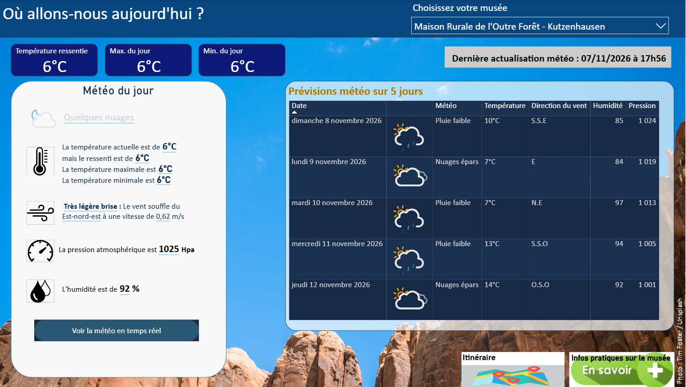
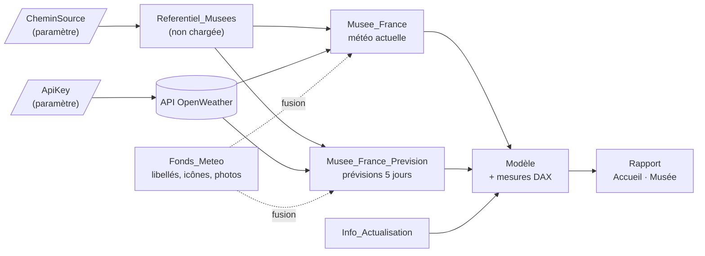

# Météo des musées du Museums-PASS

Rapport Power BI qui affiche la **météo actuelle** et les **prévisions à 5 jours** de 128 musées du réseau Museums-PASS-Musées (côté français : Grand Est et Bourgogne-Franche-Comté), à partir de l'API OpenWeather. Choisissez un musée, consultez sa météo, puis ouvrez l'itinéraire ou sa fiche pratique.


## Sommaire

- [Ce que fait le rapport](#ce-que-fait-le-rapport)
- [Fonctionnement](#fonctionnement)
- [Choix techniques](#choix-techniques)
- [Lancer le projet](#lancer-le-projet)
- [Structure du dépôt](#structure-du-dépôt)
- [Limites connues](#limites-connues)
- [Historique](#historique)
- [Sources et crédits](#sources-et-crédits)

## Ce que fait le rapport



| Zone | Contenu |
|---|---|
| Segment | Choix du musée ; toute la page suit ce choix |
| Cartes | Température ressentie, max et min du jour |
| Météo du jour | Condition, températures, vent (échelle de Beaufort), pression, humidité ; lien vers OpenWeather |
| Prévisions | Une ligne par jour sur 5 jours : le créneau le plus proche de midi |
| Boutons | Itinéraire Google Maps et fiche du musée sur museumspass.com |
| Fond | Photo qui change selon la condition météo, avec le crédit de son auteur |

Le rapport compte deux pages (Accueil et Musée), chacune avec une vue mobile.

**Comment lire les chiffres**

- **Max. et min. du jour** : la plus haute et la plus basse entre la température actuelle et les prévisions restantes de la journée. Les heures déjà écoulées ne sont pas comptées (l'API gratuite ne fournit pas d'historique).
- **Max / min « instantanés »** (bloc Météo du jour) : écart de température observé au même instant dans la zone, tel que fourni par l'API. Ce n'est pas le max ou le min de la journée.
- **Prévisions** : l'API fournit un créneau toutes les 3 h ; le tableau garde celui de midi (13 h en hiver, 11 h en été).
- **Dernière actualisation** : heure de Paris, heure d'été comprise.

## Fonctionnement



| Étape | Objets | Rôle |
|---|---|---|
| 1. Lire le référentiel | `CheminSource`, `Referentiel_Musees` | Lit une seule fois le classeur Excel des musées, par son URL (nom, adresse, coordonnées, liens) |
| 2. Interroger l'API | `Musee_France`, `Musee_France_Prevision`, `Fonds_Meteo` | Un appel météo actuelle et un appel prévisions par musée ; traduction, icône et photo par fusion avec `Fonds_Meteo` |
| 3. Modèle | Relation Prévision → Musée, `_Mesures`, `Info_Actualisation` | Mesures documentées (températures, min/max du jour, horodatage) |
| 4. Rapport | Pages Accueil et Musée | Visuels, navigation, vue mobile |

Chaque requête Power Query, étape importante, colonne et mesure porte une description.

## Choix techniques

### Un appel API que le service Power BI accepte d'actualiser

Une URL construite ligne par ligne est une **source dynamique** : le service Power BI refuse de l'actualiser. Les appels utilisent donc une URL de base fixe, avec les options `RelativePath` et `Query` de `Web.Contents` :

```m
Json.Document(Web.Contents(
    "https://api.openweathermap.org",
    [ RelativePath = "data/2.5/weather",
      Query = [ lat = [Valeur], lon = [ValeurLong], APPID = ApiKey, units = "Metric" ] ]))
```

### Des heures locales, été comme hiver

- **Dates des relevés et des prévisions** : horodatage UTC de l'API (`dt`) + décalage de la ville (`timezone`), heure d'été incluse.
- **Heure d'actualisation** : calculée sans appel externe, avec la règle européenne de l'heure d'été (derniers dimanches de mars et d'octobre). `DateTime.LocalNow()` renverrait l'heure UTC dans le service.

### Min et max du jour en DAX

```dax
Température max du jour =
VAR DateActualisation = MAX ( Info_Actualisation[DerniereActualisation] )
VAR JourReference =
    DATE ( YEAR ( DateActualisation ), MONTH ( DateActualisation ), DAY ( DateActualisation ) )
VAR MaxPrevu =
    CALCULATE (
        MAX ( Musee_France_Prevision[Température prévue (°C)] ),
        Musee_France_Prevision[Jour] = JourReference
    )
VAR TemperatureActuelle = MAX ( Musee_France[Température (°C)] )
RETURN
    MAX ( COALESCE ( MaxPrevu, TemperatureActuelle ), TemperatureActuelle )
```

- **Pas de `TODAY()`** : dans le service, il renvoie la date UTC.
- **`COALESCE`** : avec deux arguments, `MIN` et `MAX` traitent une valeur vide comme 0. Sans lui, un soir sans créneau restant afficherait 0 °C.

### Une table de correspondance unique

`Fonds_Meteo` associe chaque condition OpenWeather (17 conditions, libellé anglais de l'API) à un libellé français, une icône [Meteocons](https://github.com/basmilius/weather-icons) (variante jour ou nuit) et une photo Unsplash avec son crédit. Si l'API renvoie une condition absente de la table, l'icône OpenWeather est utilisée en secours.

## Lancer le projet

### Prérequis

- Power BI Desktop (format de projet PBIP)
- Une clé API OpenWeather : compte gratuit sur [openweathermap.org](https://openweathermap.org), rubrique « API keys »

### Étapes

1. Clonez le dépôt.
2. Déposez `GEOLOCALISATION_MUSEE_FRANCE.xlsx` sur un espace en ligne : OneDrive, SharePoint, ou utilisez directement l'URL brute (*raw*) du fichier dans ce dépôt GitHub.
3. Ouvrez `METEO_MUSEE.pbip` dans Power BI Desktop.
4. Dans *Accueil > Transformer les données > Modifier les paramètres*, remplacez les deux valeurs fictives :
   - `ApiKey` : votre clé OpenWeather (à la place de `YOUR_API_KEY`) ;
   - `CheminSource` : l'URL du classeur (à la place de l'adresse SharePoint d'exemple).
5. Appliquez les modifications, puis cliquez sur *Accueil > Actualiser*.

Le classeur est lu par URL (`Web.Contents`) et non sur le disque : l'actualisation planifiée fonctionne ainsi dans le service Power BI sans passerelle de données.

### Publication dans le service Power BI

Dans les paramètres du modèle sémantique, *Informations d'identification de la source de données* :

| Source | Authentification | Remarque |
|---|---|---|
| `api.openweathermap.org` | Anonyme | Cocher « Ignorer le test de connexion » : l'URL de base seule, sans clé, renvoie une erreur 401 |
| Classeur des musées | Compte d'organisation (OneDrive, SharePoint) ou anonyme (URL publique) | Même niveau de confidentialité que la source OpenWeather |

Activez ensuite l'actualisation planifiée.

### Questions fréquentes

| Question | Réponse |
|---|---|
| Ajouter un musée ? | Une ligne dans l'Excel ; coordonnées avec un point décimal (colonnes `Valeur` et `ValeurLong`) |
| Une condition sans libellé ni image ? | Ajouter une ligne dans `Fonds_Meteo` avec le libellé anglais exact renvoyé par l'API |
| Combien d'appels par actualisation ? | 256 : 128 musées × 2 (météo actuelle + prévisions) |
| Pourquoi des noms de colonnes en anglais dans Power Query ? | Ce sont les noms de l'API ; les noms affichés sont renommés dans le modèle (dernière étape Power Query, à ne pas modifier) |

## Structure du dépôt

```
├── METEO_MUSEE.pbip                    Point d'entrée du projet
├── METEO_MUSEE.Report/                 Pages, visuels, thème (format PBIR)
├── METEO_MUSEE.SemanticModel/          Requêtes, tables, mesures (format TMDL)
├── GEOLOCALISATION_MUSEE_FRANCE.xlsx   Référentiel des musées
├── Meteo_musees_comprendre_le_rapport.pptx   Support de présentation
├── docs/
│   ├── accueil.png                     Capture de la page Accueil
│   └── musee.png                       Capture de la page Musée
├── .gitignore
├── LICENSE
└── README.md
```

## Limites connues

- 17 conditions sont couvertes par `Fonds_Meteo` ; les autres gardent l'icône OpenWeather et n'ont pas de libellé français.
- Min / max du jour : les heures déjà écoulées ne sont pas prises en compte.
- Prévisions : le décalage horaire est figé au moment de l'actualisation (1 h d'écart possible autour des changements d'heure).
- La règle d'heure d'été européenne est écrite en dur dans `Info_Actualisation`.
- Le libellé de condition et l'icône du bloc « Météo du jour » manquent de contraste.
- 256 appels par actualisation : à surveiller face au plafond par minute de l'offre gratuite OpenWeather.
- La colonne masquée `itiniraire` n'est plus utilisée, mais un réglage résiduel des boutons y fait référence ; la supprimer casse les boutons.

## Historique

| Version | Contenu |
|---|---|
| **v1 (2024)** | Réalisée seule, pour un départ en retraite. Actualisation possible uniquement dans Power BI Desktop |
| **v2 (2026)** | Audit et refonte, avec une IA (Claude, d'Anthropic) en relecture du code et en appui sur la documentation |

Principaux apports de la v2 :

- actualisation planifiée dans le service, grâce à des sources API statiques ;
- dates corrigées (décalage de +7 h) et heures des prévisions en heure locale ;
- 387 → 256 appels API par actualisation (appel inutile supprimé) ;
- modèle allégé : 14 → 4 tables, 11 mesures inutilisées supprimées, colonnes et mesures documentées ;
- vraies min / max du jour, icônes plus précises, crédits photo, page d'accueil et vues mobiles ;
- clé API et chemin du fichier sortis du code, dans deux paramètres.

## Sources et crédits

| Élément | Source | Conditions |
|---|---|---|
| Référentiel des musées | [Museums-PASS-Musées](https://www.museumspass.com) | Données publiques du site |
| Données météo | [OpenWeather](https://openweathermap.org) | Conditions d'utilisation de l'API OpenWeather |
| Icônes météo | [Meteocons](https://github.com/basmilius/weather-icons), Bas Milius | Licence MIT ; chargées depuis jsDelivr |
| Photos de fond | [Unsplash](https://unsplash.com) | Licence Unsplash ; auteur affiché sur la page Musée |
| Illustration de l'accueil, support de présentation, relecture du code | Claude (Anthropic) | — |

Documentation Microsoft utile :

- [Web.Contents : RelativePath et Query](https://learn.microsoft.com/en-us/powerquery-m/web-contents)
- [Actualisation des données et sources dynamiques](https://learn.microsoft.com/en-us/power-bi/connect-data/refresh-data)
- [COALESCE (DAX)](https://learn.microsoft.com/en-us/dax/coalesce-function-dax)
- [MIN (DAX)](https://learn.microsoft.com/en-us/dax/min-function-dax)

## Licence

Le code de ce projet (requêtes, mesures, définition du rapport) est publié sous licence MIT : voir [LICENSE](LICENSE). Les données, icônes et photos restent soumises aux conditions de leurs sources respectives.
